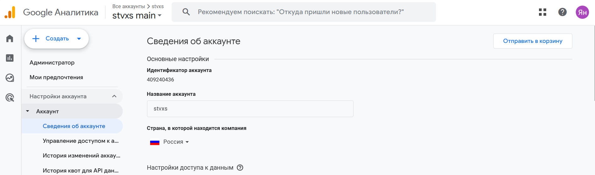
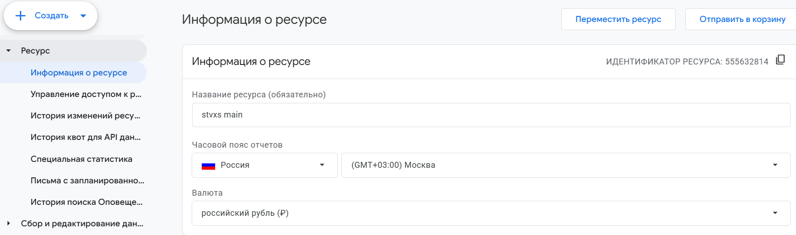
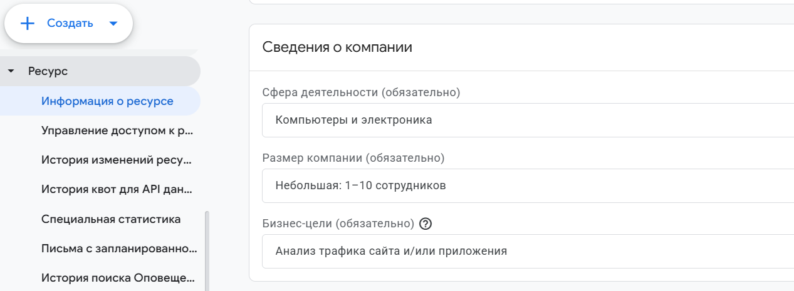
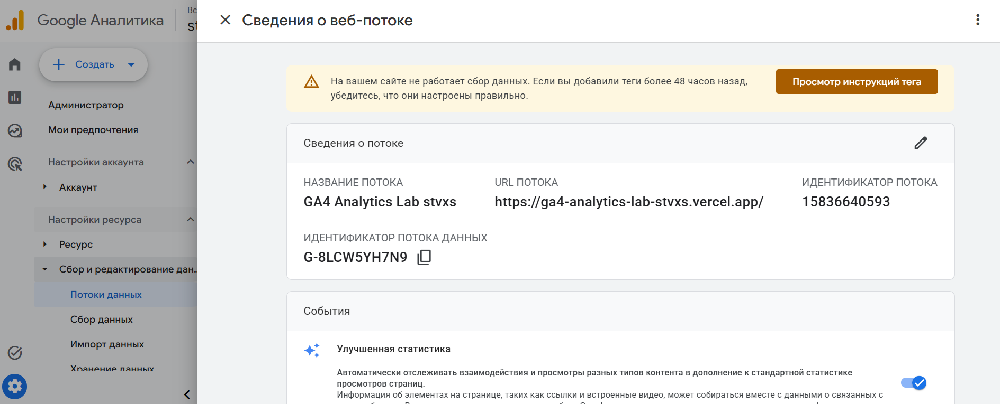

# Домашняя работа № 2 · Где бизнес теряет клиентов

**Дисциплина:** ОП.03 «Информационные технологии»

| Поле | Значение |
|---|---|
| Фамилия, имя, отчество | Орищенко Ян Владиславович |
| Группа | 11/1-РПО-26/1 |
| Номер работы | 2 |
| Тема работы | Анализ воронки цифрового продукта и структура Google Analytics 4 |
| Дата сдачи | 23.10.2026 |

---

# Часть 1. Исследование воронки

## 1.1. Объект исследования

| Поле | Значение |
|---|---|
| Компания, сервис или отрасль | маркетплейс Wildberries |
| Адрес сайта или приложения | https://www.wildberries.ru/ |
| Целевое действие | покупка товара пользователем. |
| Почему выбран этот объект | Wildberries - российский маркетплейс, на котором можно исследовать путь пользователя от поиска товара до оформления заказа. Для анализа можно использовать официальный отчёт Wildberries «Воронка продаж», исследования российского рынка электронной торговли и опубликованные кейсы российских компаний. Я сам пользуюсь этим маркетплейсом, поэтому мне интересно изучить, на каких этапах покупатели могут отказаться от покупки. |

## 1.2. Воронка

| № | Этап | Что считается переходом дальше | Метрика этапа |
|---|---|---|---|
| 1 | Посещение сайта или приложения | Пользователь открывает карточку товара | Количество посещений и доля пользователей, перешедших к просмотру товара |
| 2 | Просмотр карточки товара | Пользователь добавляет товар в корзину | Конверсия из просмотра карточки в добавление в корзину |
| 3 | Добавление в корзину | Пользователь начинает оформление заказа | Конверсия из добавления в корзину в начало оформления |
| 4 | Начало оформления заказа | Пользователь завершает оформление заказа | Конверсия из начала оформления в заказ |
| 5 | Заказ оформлен | Целевое действие достигнуто | Количество заказов и общая конверсия от посещения до заказа |

## 1.3. Источники

### Источник 1

| Поле | Значение |
|---|---|
| Название материала | Интернет-торговля в России 2025 |
| Автор или организация | Data Insight |
| Дата публикации | 19.05.2025 |
| Прямая ссылка | https://datainsight.ru/DI_eCommerce_2025 |

**Выписка из материала:**

> По данным Data Insight, в 2024 году объём российского рынка розничной интернет-торговли составил 11,2 трлн рублей, а количество заказов достигло 6,8 млрд.

**Что подтверждает и как связано с моей воронкой:**

>Источник показывает масштаб российского рынка интернет-торговли. Чтобы покупка состоялась, пользователю необходимо пройти несколько этапов: от посещения сайта до выбора товара и оформления заказа. Поэтому важно анализировать переходы между этапами воронки.

**Цифры из источника и этап воронки, к которому относятся:**

>11,2 трлн рублей - объём российского рынка розничной интернет-торговли, 6,8 млрд - количество заказов в 2024 году. Эти показатели относятся к интернет-торговле в целом и не показывают конверсию Wildberries на отдельных этапах воронки.

### Источник 2

| Поле | Значение |
|---|---|
| Название материала | По маркетплейсам! Тренды онлайн-потребления - 2024 |
| Автор или организация | Всероссийский центр изучения общественного мнения (ВЦИОМ) |
| Дата публикации | 10.10.2024 |
| Прямая ссылка | https://wciom.ru/analytical-reviews/analiticheskii-obzor/po-marketpleisam-trendy-onlain-potreblenija-2024 |

**Выписка из материала:**

> По данным ВЦИОМ, 71% россиян совершали покупки онлайн за последний год. Среди онлайн-покупателей 92% пользовались маркетплейсами. Среди критериев выбора товара цена отмечалась 47% опрошенных, отзывы - 46%.

**Что подтверждает и как связано с моей воронкой:**

>Исследование показывает, что маркетплейсы широко используются российскими покупателями. Цена и отзывы могут влиять на решение о покупке. Если цена не устраивает пользователя или отзывы вызывают сомнения, он может просмотреть карточку товара, но не добавить товар в корзину.

**Цифры из источника и этап воронки:**

>71% россиян совершали покупки онлайн за последний год, а среди онлайн-покупателей 92% пользовались маркетплейсами. Цена была важным критерием для 47% опрошенных, отзывы - для 46%. Эти данные относятся к поведению покупателей и выбору товара, но не являются статистикой конверсии Wildberries.

### Источник 3

| Поле | Значение |
|---|---|
| Название материала | Рекомендуемые события в Google Analytics 4 |
| Автор или организация | Google Analytics |
| Дата публикации | Не указана |
| Прямая ссылка | https://support.google.com/analytics/answer/9267735?hl=ru |

**Выписка из материала:**

> Google рекомендует использовать события `view_item`, `add_to_cart`, `begin_checkout` и `purchase` для отслеживания действий пользователей при покупках в интернете.

**Что подтверждает и как связано с моей воронкой:**

>События аналитики помогают отслеживать путь покупателя от просмотра товара до покупки. Если пользователи часто просматривают товары, но редко добавляют их в корзину, это может указывать на проблему на соответствующем этапе воронки. Анализ событий помогает определить, где нужно искать причины потери пользователей.

**Цифры из источника и этап воронки:**

>В материале перечислены события аналитики, но конкретные показатели конверсии не приводятся. Событие `view_item` относится к просмотру товара, `add_to_cart` - к добавлению в корзину, `begin_checkout` - к началу оформления, `purchase` - к покупке.

### Источник 4

| Поле | Значение |
|---|---|
| Название материала | Ecommerce Checkout Usability Report |
| Автор или организация | Baymard Institute |
| Дата публикации | 02.02.2025 |
| Прямая ссылка | https://baymard.com/research-articles/ecommerce-checkout-usability-report-and-benchmark |

**Выписка из материала:**

> По данным Baymard Institute, средняя доля брошенных корзин в интернет-магазинах составляет около 70%.

**Что подтверждает и как связано с моей воронкой:**

>Данные показывают, что добавление товара в корзину не гарантирует покупку. Пользователь может отказаться от заказа из-за дополнительных расходов, неудобного оформления или других препятствий. Поэтому важно анализировать переход от корзины к завершению заказа.

**Цифры из источника и этап воронки:**

>Около 70% корзин остаются без завершённой покупки по оценке Baymard Institute. Этот ориентир относится к этапу между добавлением товара в корзину и завершением заказа. Он не является фактической статистикой Wildberries.

### Источник 5

| Поле | Значение |
|---|---|
| Название материала | Отчёт «Воронка продаж» |
| Автор или организация | Wildberries |
| Дата публикации | Обновлено 23.10.2026 |
| Прямая ссылка | https://seller.wildberries.ru/instructions/ru/ru/material/sales-funnel-report |

**Выписка из материала:**

> Wildberries предоставляет отчёт «Воронка продаж», который позволяет анализировать путь покупателя от просмотра карточки товара до добавления в корзину и заказа. Конверсия в корзину рассчитывается как отношение количества добавлений в корзину к количеству переходов в карточку товара.

**Что подтверждает и как связано с моей воронкой:**

>Официальный отчёт Wildberries помогает анализировать переходы между этапами покупки. Если карточки товаров просматривают часто, но добавляют товары в корзину редко, стоит проверить цены, фотографии, описание и отзывы. Анализ следующих этапов помогает выявить возможные проблемы с оформлением заказа.

**Цифры из источника и этап воронки:**

>В официальном примере Wildberries из 1000 переходов в карточку товара 100 заканчиваются добавлением товара в корзину. Конверсия в корзину составляет 10%: (100 ÷ 1000) × 100%. Это пример расчёта, а не средний показатель всей площадки. Этап воронки: просмотр карточки товара -> добавление в корзину.

## 1.4. Реальные кейсы

### Кейс 1

| № | Пункт | Ответ |
|---|---|---|
| 1 | Компания, продукт или рынок | Интернет-магазин S&S Shop, продающий аксессуары для PlayStation и Xbox на маркетплейсе Ozon. |
| 2 | Как выглядела воронка или её проблемный участок | Привлечение покупателей через поиск и рекламу, переходы в карточки товаров, добавление в корзину и покупка. |
| 3 | В чём заключалась проблема | Рекламные расходы были высокими, а маркетинговые инструменты и оформление карточек товаров использовались недостаточно эффективно. |
| 4 | Какие данные или наблюдения подтвердили проблему | До изменений конверсия из карточки товара в корзину составляла 17,1%, а расходы на рекламу «Трафареты» были близки к 40% от продаж. |
| 5 | Что изменили или протестировали | Провели аудит магазина, переработали рекламу, улучшили описания, SEO, инфографику и дополнительный контент карточек товаров. |
| 6 | Как изменился результат | В октябре по сравнению с сентябрём количество проданных товаров выросло с 2177 до 2722, конверсия в корзину увеличилась с 17,1% до 20,1%, а сумма продаж выросла с 2 647 397 до 3 371 028 рублей. |
| 7 | Можно ли перенести подход на Wildberries | Да. Можно анализировать эффективность карточек товаров, рекламу и конверсию между просмотром товара и добавлением в корзину. Результаты кейса относятся к конкретному продавцу на Ozon и не являются статистикой Wildberries. |

**Ссылка на источник кейса:**

>https://adwai.digital/portfolio/keys-audit-trafarety-ozon

### Кейс 2

| № | Пункт | Ответ |
|---|---|---|
| 1 | Компания, продукт или рынок | Kanzler, российский интернет-магазин мужской одежды. |
| 2 | Как выглядела воронка или её проблемный участок | Посещение сайта, просмотр карточки товара, выбор размера, бронирование или оформление заказа. |
| 3 | В чём заключалась проблема | Карточки товаров медленно загружались, мобильная навигация была неудобной, выбор размера был недостаточно понятным, а некоторые элементы функционала работали с ошибками. |
| 4 | Какие данные или наблюдения подтвердили проблему | До изменений конверсия составляла 0,438%. Время выполнения запросов к базе данных достигало 2,5371 секунды. |
| 5 | Что изменили или протестировали | Обновили дизайн карточек, упростили выбор размера, исправили ошибки бронирования и оптимизировали код для ускорения загрузки страниц. |
| 6 | Как изменился результат | После изменений конверсия составила 1,367%, то есть выросла примерно в 3,1 раза. Скорость загрузки карточки товара увеличилась в 2,5 раза. Сравнивались май-июнь 2022 года и май-июнь 2023 года. На результат также могли повлиять расширение ассортимента и корректировка учёта остатков. |
| 7 | Можно ли перенести подход на Wildberries | Да. Полезно проверять скорость загрузки, удобство мобильной версии, понятность информации о товаре и простоту оформления заказа. Это пример другой компании, а не статистика Wildberries. |

**Ссылка на источник кейса:**

>https://ruward.ru/cases/6283/

## 1.5. Причины потери пользователей

| № | Этап воронки | Причина потери | Какой источник это подтверждает |
|---|---|---|---|
| 1 | Просмотр карточки товара -> добавление в корзину | Покупателя могут не устроить цена, фотографии, описание или отзывы о товаре. В результате он просматривает карточку, но не добавляет товар в корзину. | Кейс продавца на Ozon, ADWAI: https://adwai.digital/portfolio/keys-audit-trafarety-ozon |
| 2 | Добавление в корзину -> оформление заказа | Покупатель может отказаться от покупки из-за дополнительных расходов, например доставки, или неудобного процесса оформления заказа. | Baymard Institute, Ecommerce Checkout Usability Report: https://baymard.com/research-articles/ecommerce-checkout-usability-report-and-benchmark |
| 3 | Просмотр карточки товара -> выбор товара или заказ | Медленная загрузка страницы, неудобная мобильная навигация и сложности с выбором размера могут помешать покупателю продолжить оформление заказа. | Кейс интернет-магазина Kanzler: https://ruward.ru/cases/6283/ |

## 1.6. Гипотезы улучшения

| № | Этап | Гипотеза | Какие данные нужно собрать | Как проверить, сработало |
|---|---|---|---|---|
| 1 | Просмотр карточки товара -> добавление в корзину | Если улучшить фотографии товара, описание и заметность кнопки «Добавить в корзину», то больше пользователей будут добавлять товар в корзину. | Просмотры карточек, количество добавлений в корзину, конверсия в добавление в корзину. | Провести A/B-тест двух вариантов карточки товара и сравнить конверсию в добавление в корзину. |
| 2 | Добавление в корзину -> оформление заказа | Если заранее показывать стоимость и условия доставки, то меньше пользователей будут отказываться от оформления заказа. | Количество добавлений в корзину, начала оформления заказа и отказов на этом этапе. | Сравнить конверсию из корзины в начало оформления до и после изменения. |
| 3 | Начало оформления -> покупка | Если упростить оформление заказа и убрать необязательные поля, то больше пользователей будут завершать покупку. | Количество начатых оформлений, количество покупок, доля завершённых оформлений и ошибки при оформлении. | Провести A/B-тест упрощённой формы оформления и сравнить долю пользователей, завершивших покупку. |

---

# Часть 2. Google Analytics 4

## 2.1. Пройденные шаги

| № | Шаг | Выполнено |
|---|---|---|
| 1 | Вход в Google Analytics под своим аккаунтом | да |
| 2 | Создан Analytics Account | да |
| 3 | Создан Property | да |
| 4 | Выбраны часовой пояс, валюта и общие сведения | да |
| 5 | Выбраны бизнес-цели | да |
| 6 | Создан ресурс | да |
| 7 | Создан Web Data Stream | да |
| 8 | Проверены Website URL, Stream name, Enhanced Measurement | да |
| 9 | Поток создан | да |
| 10 | Найден Measurement ID | да |

## 2.2. Что получилось

| Поле | Значение |
|---|---|
| Analytics Account | stvxs |
| Property | stvxs main |
| Reporting time zone | (GMT+03:00) Москва |
| Currency | Российский рубль (RUB) |
| Выбранные бизнес-цели | Анализ трафика сайта и/или приложения |
| Stream name | GA4 Analytics Lab stvxs |
| Website URL | https://ga4-analytics-lab-stvxs.vercel.app/ |
| Stream ID (числовой) | 15836640593 |
| Measurement ID (`G-…`) | `G-8LCW5YH7N9` |
| Enhanced Measurement | включено |

## 2.3. Скриншоты

Скриншот: 

Скриншот: 

Скриншот: 

Скриншот: 

Скриншот: 

---

## Использование ИИ

Источники вы ищете, читаете и проверяете сами, настройку проходите тоже
сами. ИИ допускается для поиска идей, структурирования и проверки
формулировок, но источником он не считается.

| Вопрос | Ответ |
|---|---|
| Что сделано самостоятельно | Найдены и изучены источники по теме интернет-торговли, конверсии и аналитики. Самостоятельно выполнена настройка Google Analytics 4, проверены параметры ресурса и веб-потока, сделаны скриншоты. |
| Что спрошено у модели |  Запрошена помощь в структурировании материала, оформлении таблиц Markdown, описании воронки продаж, причин потери пользователей и улучшения гипотез. |
| Что после этого проверено и изменено | Проверены настройки Google Analytics 4 по собственным скриншотам. Отредактированы формулировки и оформление Markdown. |
