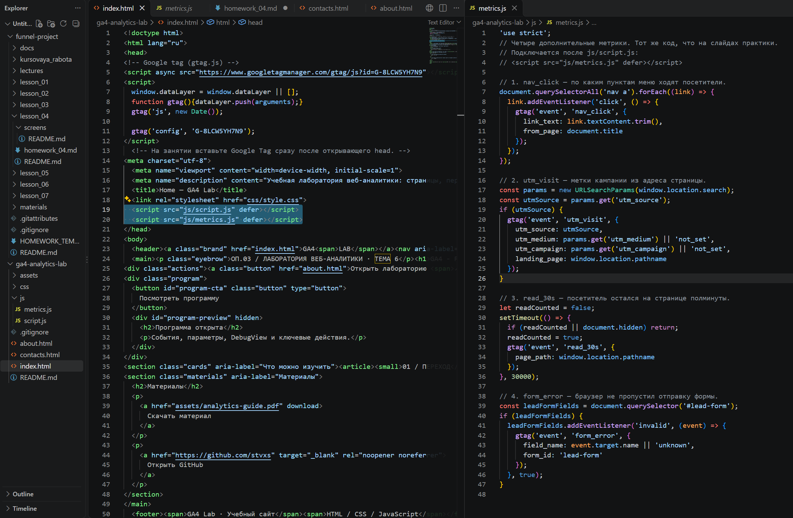
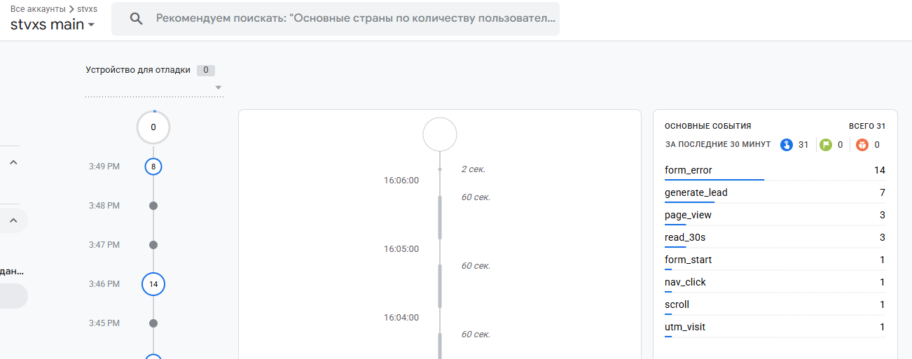
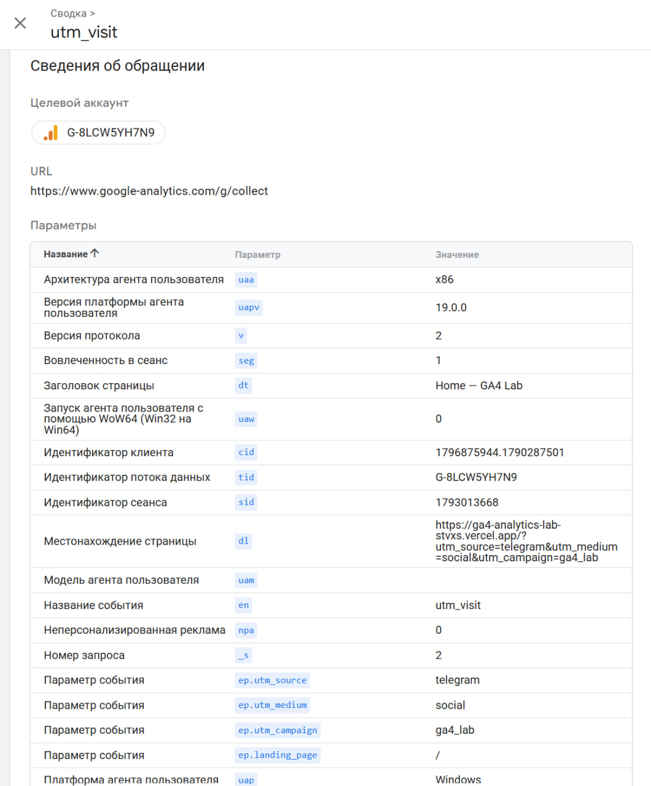
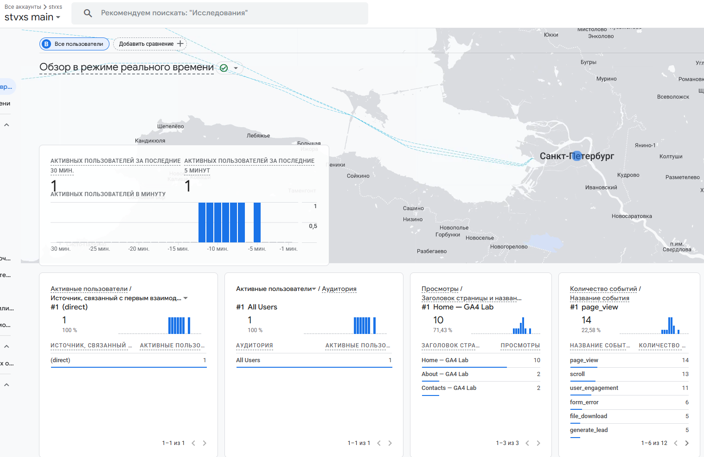

# Домашняя работа № 4 · Свои события и параметры в GA4

**Дисциплина:** ОП.03 «Информационные технологии»

| Поле | Значение |
|---|---|
| Фамилия, имя, отчество | Орищенко Ян Владиславович |
| Группа | 1/1-РПО-26/1 |
| Номер работы | 4 |
| Тема работы | Свои события и параметры: четыре метрики на сайте |
| Дата сдачи | 26.10.2026 |

---

## 1. Мой сайт и мой ресурс

| Поле | Значение |
|---|---|
| Публичный адрес сайта | https://ga4-analytics-lab-stvxs.vercel.app/ |
| Measurement ID (`G-…`) | G-8LCW5YH7N9 |
| Коммит с метриками (ссылка или первые 7 символов) | https://github.com/stvxs/ga4-analytics-lab/commit/12ba05b75330e23a1b8aca2fa27443a1ad2c0d0d |
| Статус публикации | READY |
| Страницы, где подключён `js/metrics.js` | index.html, about.html, contacts.html |

Файл подключается после основного скрипта и на каждой странице по одному
разу: два подключения дают двойные события.

## 2. Какие метрики добавлены

| Событие | Что измеряет | Что делали, чтобы оно сработало |
|---|---|---|
| `nav_click` | клики по пунктам меню |Нажимал на пункт меню на сайте, который мне открыл google tag, потом проверял событие в DebugView. |
| `utm_visit` | метки кампании из адреса | Ввел ссылку с UTM-метками в строку сайта google tag, потом проверял значения в DebugView. |
| `read_30s` | полминуты на странице | Я оставил вкладку сайта открытой на 30 секунд и проверил событие в DebugView. |
| `form_error` | форма не прошла проверку браузера | Я отправил форму с пустыми обязательными полями и проверил событие в DebugView. |

Скриншот: `

## 3. События в DebugView

| Поле | Значение |
|---|---|
| Дата и время проверки | 16:06 |
| Как подключали отладку | Tag Assistant |
| Какие из четырёх событий пришли | nav_click, utm_visit, read_30s, form_error |
| Какие не пришли и почему | Пришли все |

Скриншот: 

## 4. Параметры события `utm_visit`

**Ссылка, по которой открывали сайт:**

```
https://ga4-analytics-lab-stvxs.vercel.app/?utm_source=telegram&utm_medium=social&utm_campaign=ga4_lab
```

| Параметр | Значение в ссылке | Значение в GA4 |
|---|---|---|
| `utm_source` | telegram | telegram |
| `utm_medium` | social | social |
| `utm_campaign` | ga4_lab | ga4_lab |
| `landing_page` | — | / |

Скриншот: 


## 5. Событие вне отладки

| Поле | Значение |
|---|---|
| Где проверяли | Realtime |
| Какое событие искали | form_error  |
| Сколько срабатываний показал экран | 6 |
| Период (для отчёта) | - |

Скриншот: `

## 6. Что эти метрики показывают про сайт

>Я добавил и проверил четыре метрики: nav_click, utm_visit, read_30s и form_error. Они позволяют узнать, по каким пунктам меню переходят посетители, откуда приходят на сайт, остаются ли на странице не менее 30 секунд и возникают ли ошибки при заполнении формы. Во время моей проверки все четыре события сработали

## 7. Что не получилось

Если какая-то метрика не заработала, напишите какая, что показывал экран
и что было проверено по таблице из `README.md`. Незаполненный раздел
означает, что всё получилось.

>Все получилось

## 8. Использование ИИ

Скрипты метрик выданы готовыми. Подключение, проверку и кадры вы делаете
сами. ИИ допускается для формулировок и оформления.

| Вопрос | Ответ |
|---|---|
| Что сделано самостоятельно | Я подключил готовые скрипты к страницам сайта, настроил отладку через Google Tag Assistant, проверил события и сделал скриншоты. |
| Что спрошено у модели | Помощь в формлении отчета md |
| Что после этого изменено | Я проверил  формулировки отчёта, значения параметров событий |
