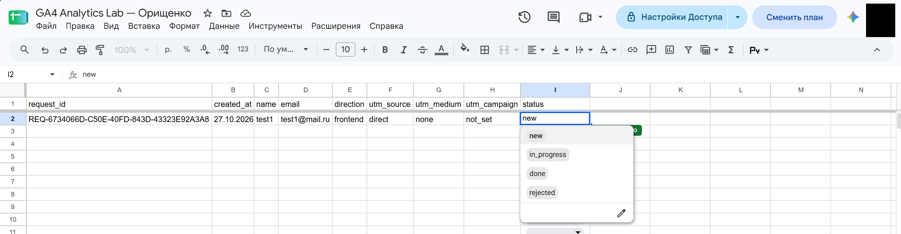
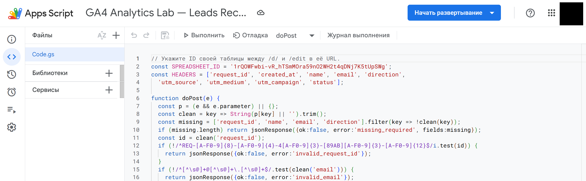
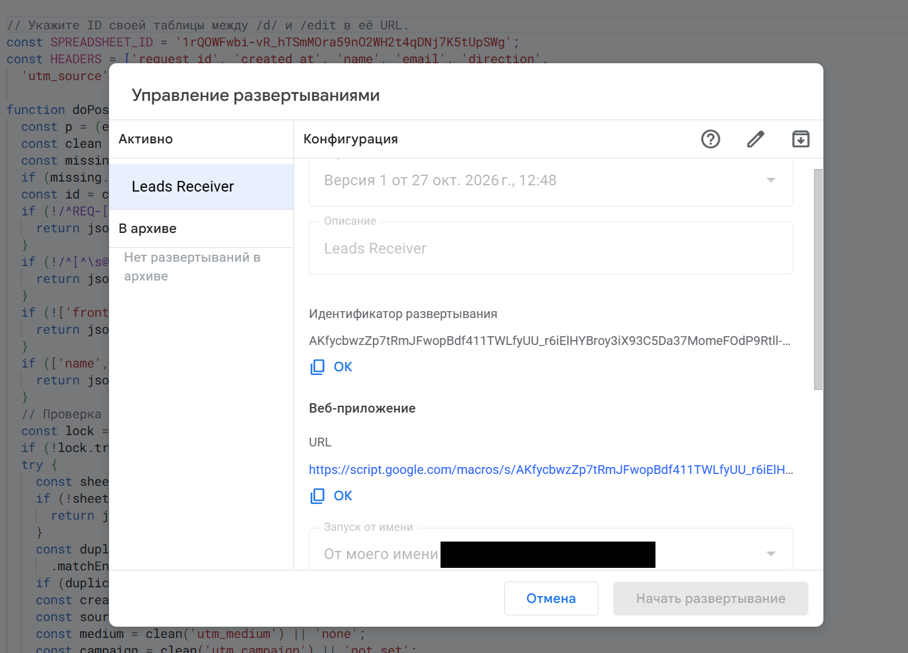
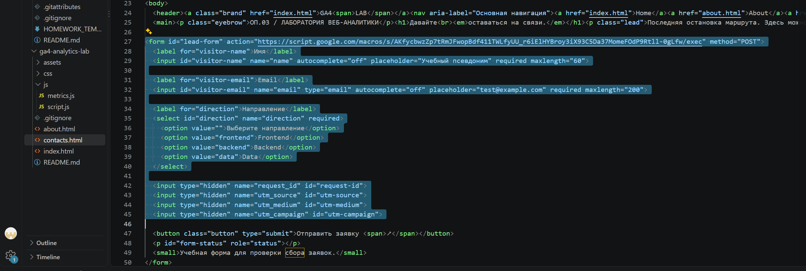
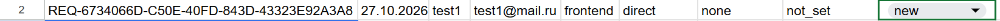
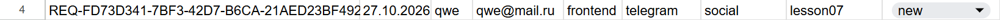
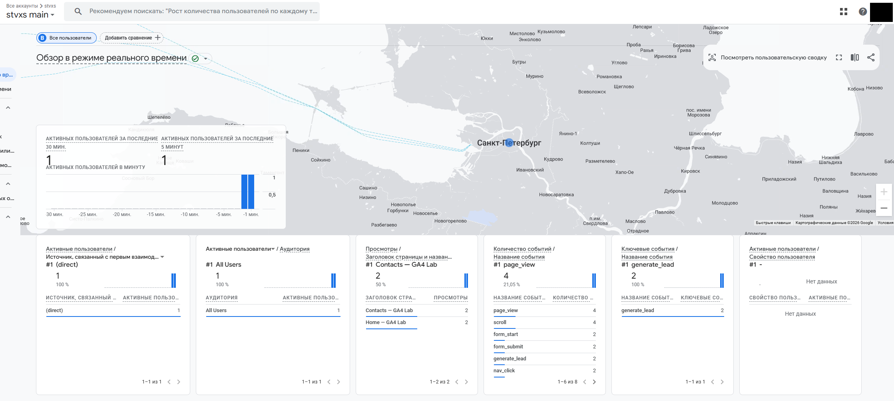
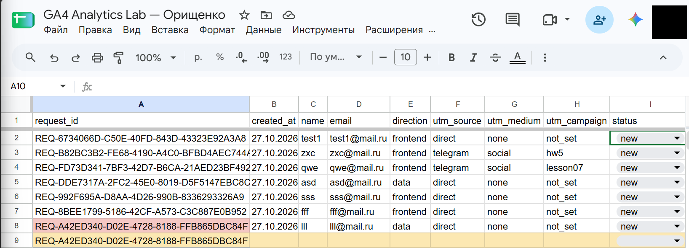
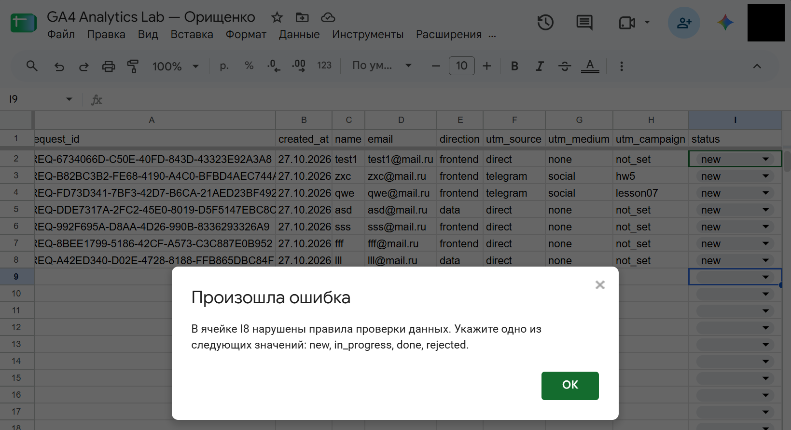

# Домашняя работа № 5 · Контролируемая таблица заявок

**Дисциплина:** ОП.03 «Информационные технологии»

| Поле | Значение |
|---|---|
| Фамилия, имя, отчество | Орищенко Ян Владиславович |
| Группа | 11/1-РПО-26/1 |
| Номер работы | 5 |
| Тема работы | Форма сайта → Apps Script → Google Таблица заявок |
| Дата сдачи | 27.10.2026 |

---

## 1. Таблица

Я создал таблицу «GA4 Analytics Lab — Leads» с листом `Орищенко`. В первой
строке девять заголовков: `request_id`, `created_at`, `name`, `email`,
`direction`, `utm_source`, `utm_medium`, `utm_campaign`, `status`. Строка
заголовков закреплена, у статуса список из четырёх значений: `new`,
`in_progress`, `done`, `rejected`. Два правила подсвечивают неполную строку
и повторный `request_id`.

Ссылка на таблицу (доступ открыт только преподавателю): https://docs.google.com/spreadsheets/d/1rQOWFwbi-vR_hTSmMOra59nO2WH2t4qDNj7K5tUpSWg/

>для доступа преподавателю нужна его почта

Скриншот: 

## 2. Приёмник и форма

Я вставил `Code.gs` из материалов в Apps Script, указал ID своей таблицы
и опубликовал проект как Web app. Форму в `contacts.html` заменил
фрагментом из материалов, в `action` поставил адрес своего Web app,
обработчик формы в `js/script.js` заменил новым.

| Мои данные | Значение |
|---|---|
| Публичный адрес сайта | https://ga4-analytics-lab-stvxs.vercel.app/ |
| Measurement ID (`G-…`) | G-8LCW5YH7N9 |
| Коммит с новой формой (первые 7 символов) | 96b6f98 |

Скриншот: 

Скриншот: 

Скриншот: `

## 3. Две тестовые заявки

Первую заявку я отправил со страницы без меток: в таблице записалось
`direct` / `none` / `not_set` и статус `new`. Вторую отправил по ссылке
с метками `telegram` / `social` / `lesson07`, и они записались в свои
столбцы.

| | Заявка без меток | Заявка с метками |
|---|---|---|
| `request_id` | REQ-6734066D-C50E-40FD-843D-43323E92A3A8 | REQ-FD73D341-7BF3-42D7-B6CA-21AED23BF492 |

Скриншот: 

Скриншот: 

## 4. Событие в аналитике

После отправки в GA4 пришло событие `generate_lead`. Оно показывает
попытку отправки формы, а сама заявка подтверждается строкой в таблице.

Скриншот: 

## 5. Проверки

Форма с пустым именем не отправилась. Повторная отправка без кнопки
«Новая заявка» не добавила строку. Копия строки с тем же `request_id`
подсветилась, после кадра я её удалил. Статус `finished` таблица
не приняла, а через список статус сменился `new` → `in_progress` → `done`.

Скриншот: 

Скриншот: 

---

Не получилось (если всё работает, оставьте пустым): ___

ИИ: использовал для помощи в оформлении отчёта и формулировок
