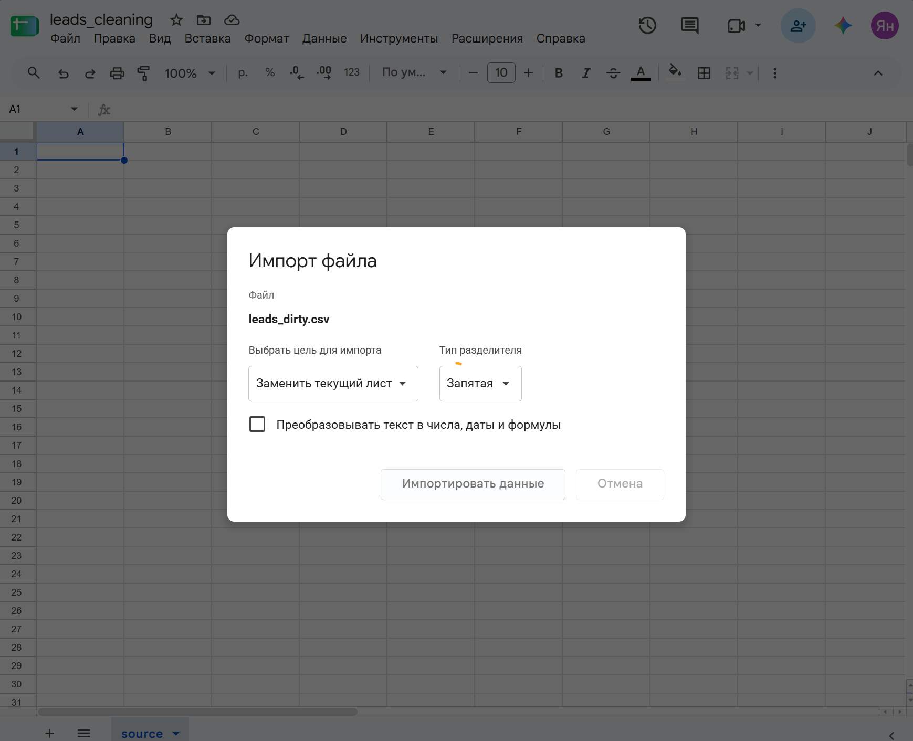
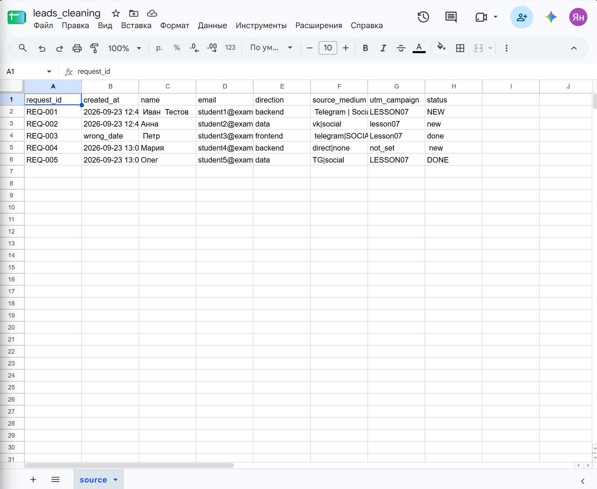
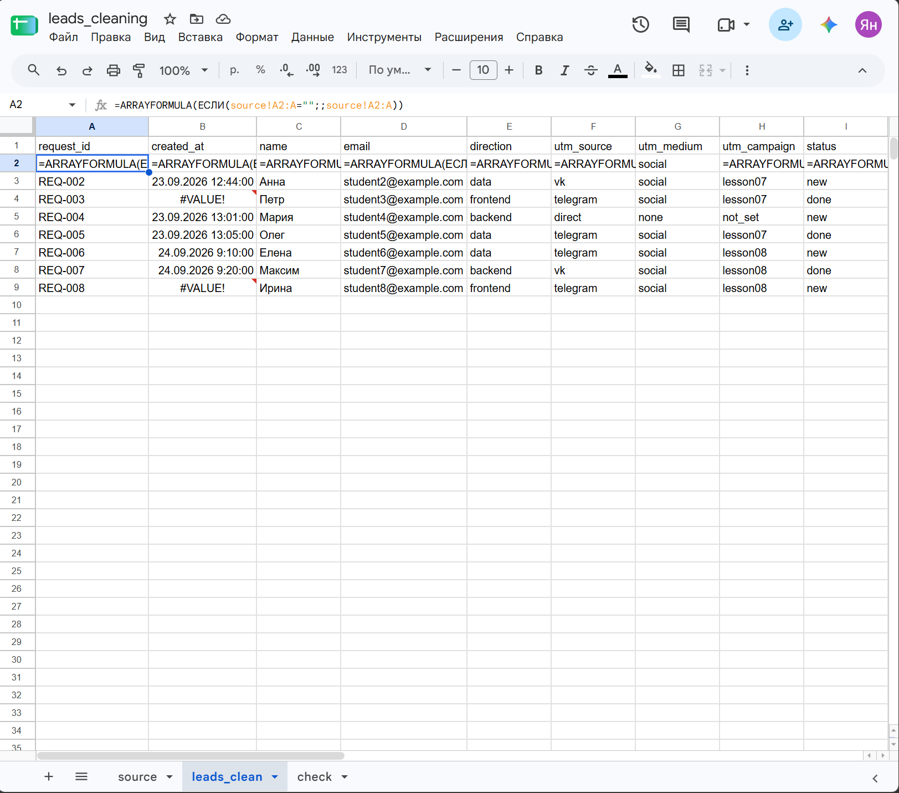
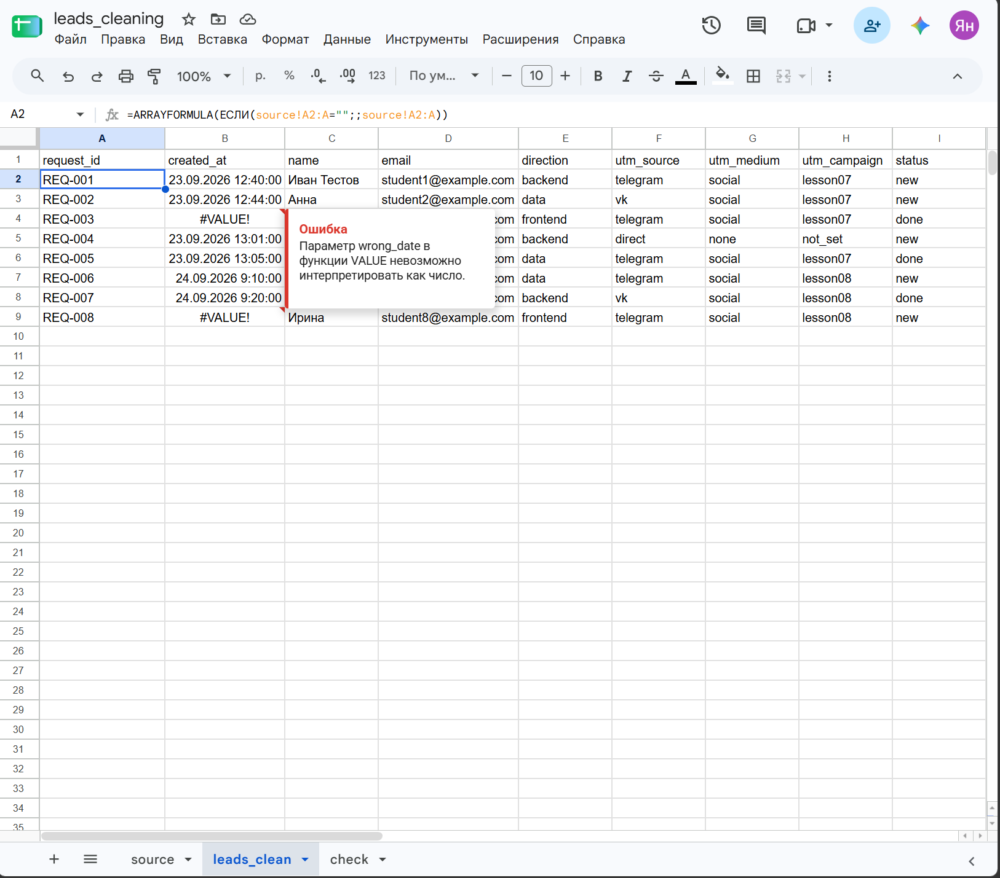
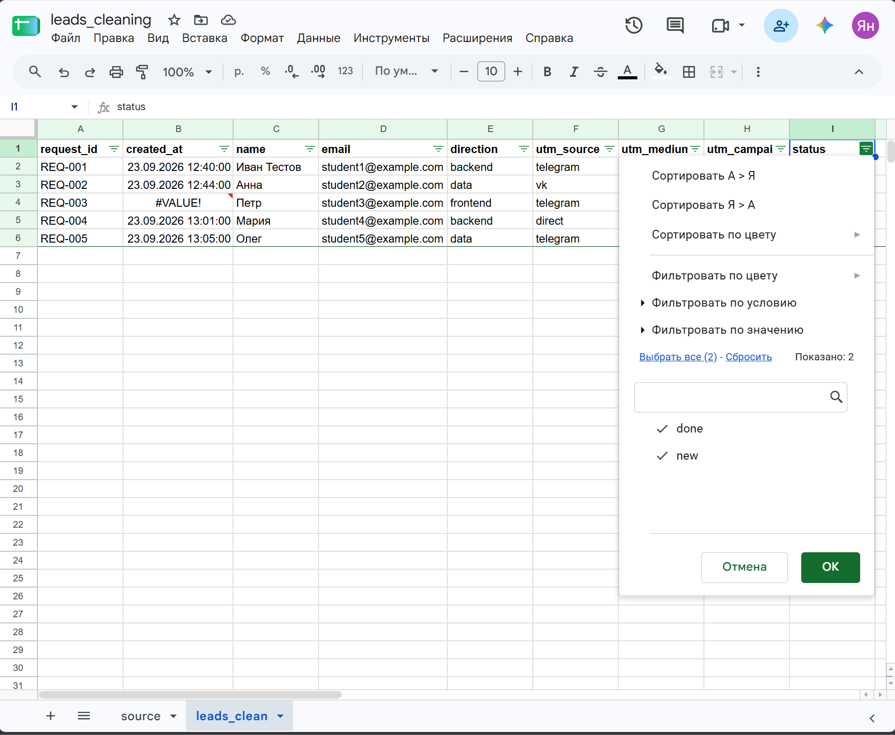
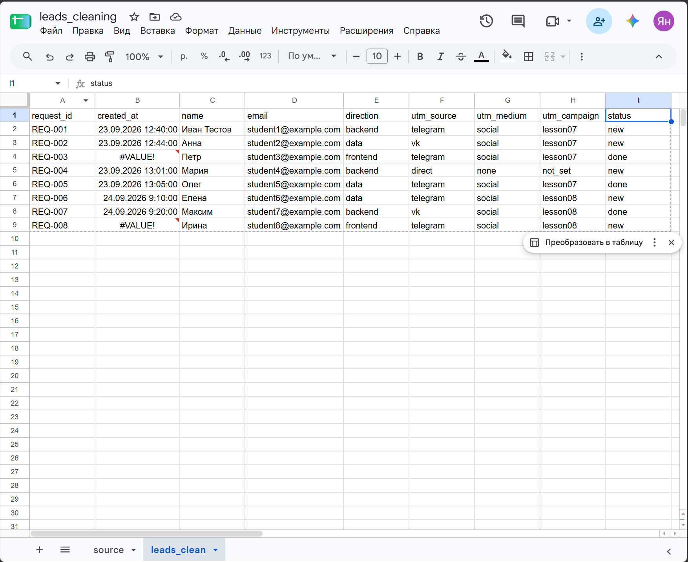
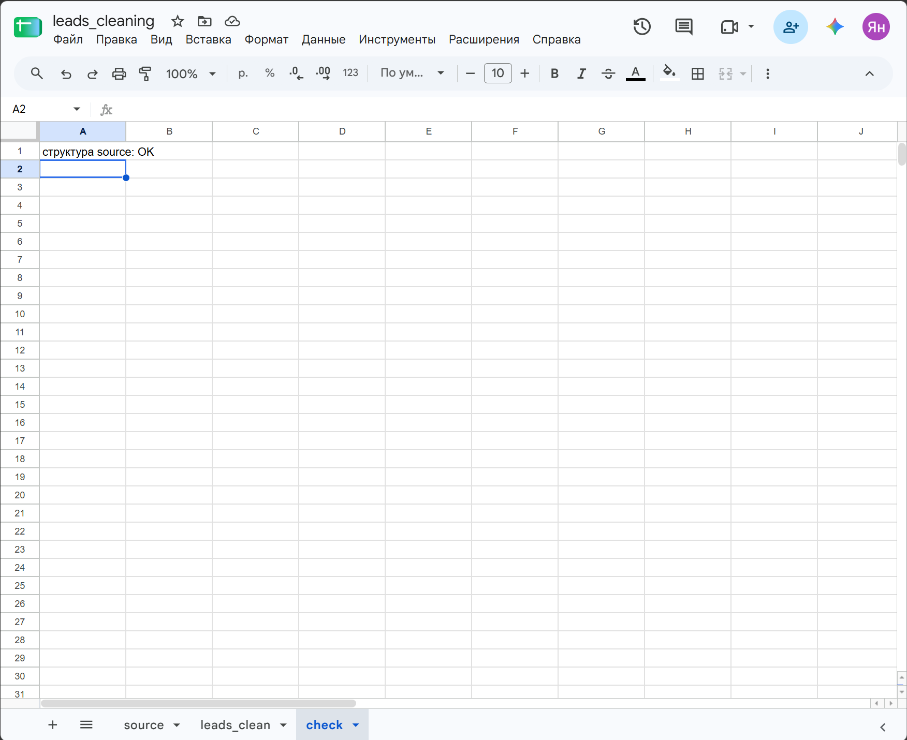

# Скриншоты задания 6

Формат PNG. Имена файлов:

| Файл | Что на кадре |
|---|---|
| `01-import.png` | окно «Импорт файла»: цель «Заменить текущий лист», флажок преобразования снят |
| `02-source.png` | лист `source` после импорта `leads_dirty.csv` |
| `03-formulas.png` | лист `leads_clean` в режиме **Вид → Показать → Формулы** |
| `04-value-error.png` | ячейка с `#VALUE!` и её подсказка |
| `05-status-filter.png` | раскрытый фильтр в заголовке `status` |
| `06-v2.png` | лист `leads_clean` после импорта v2, видна строка `REQ-006` |
| `07-check.png` | лист `check` с результатом проверки структуры |

На кадрах должны быть видны название таблицы и вкладки листов внизу.

Этот файл удалять не нужно.
