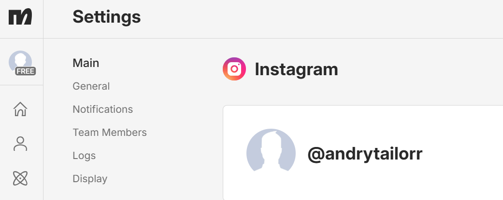
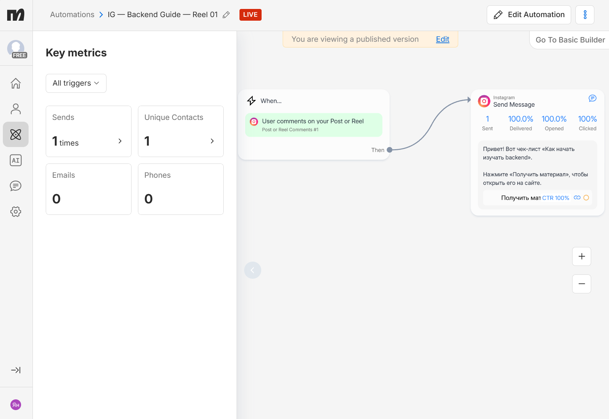
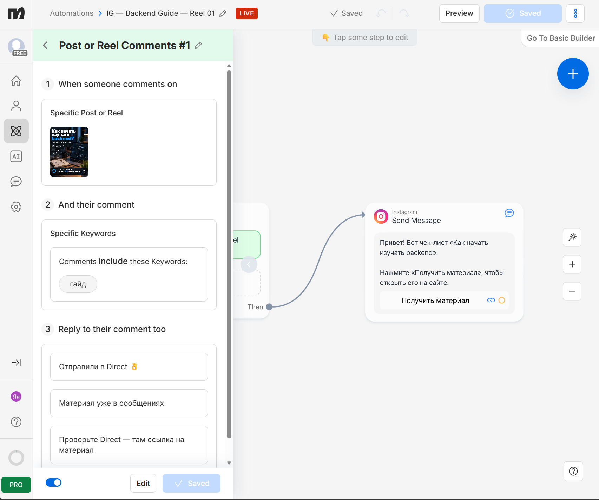
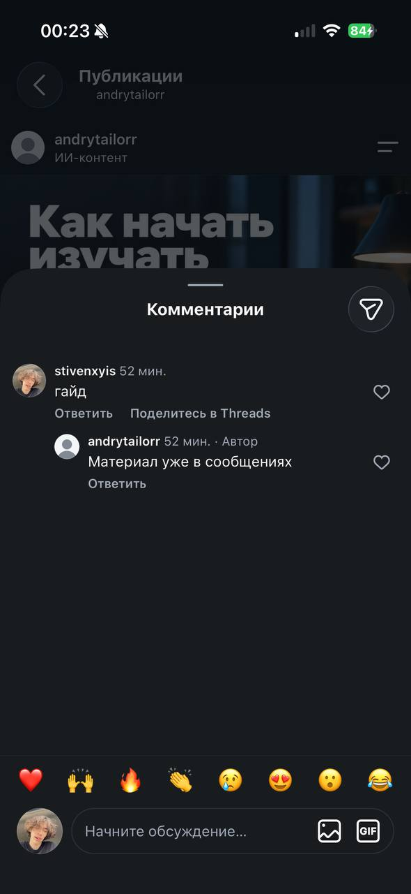
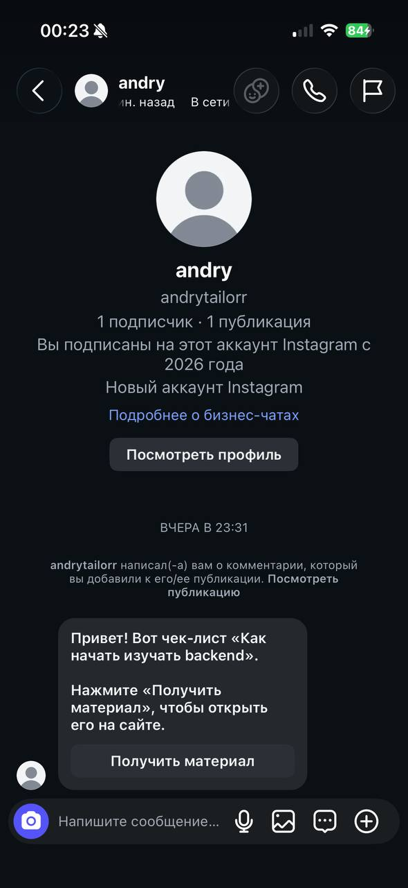
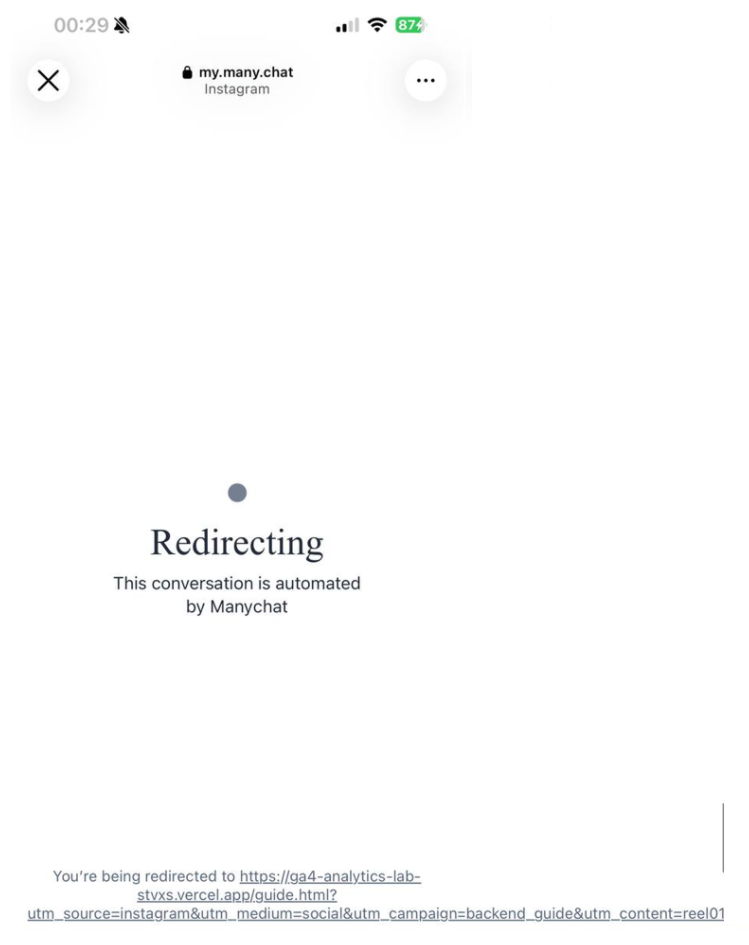
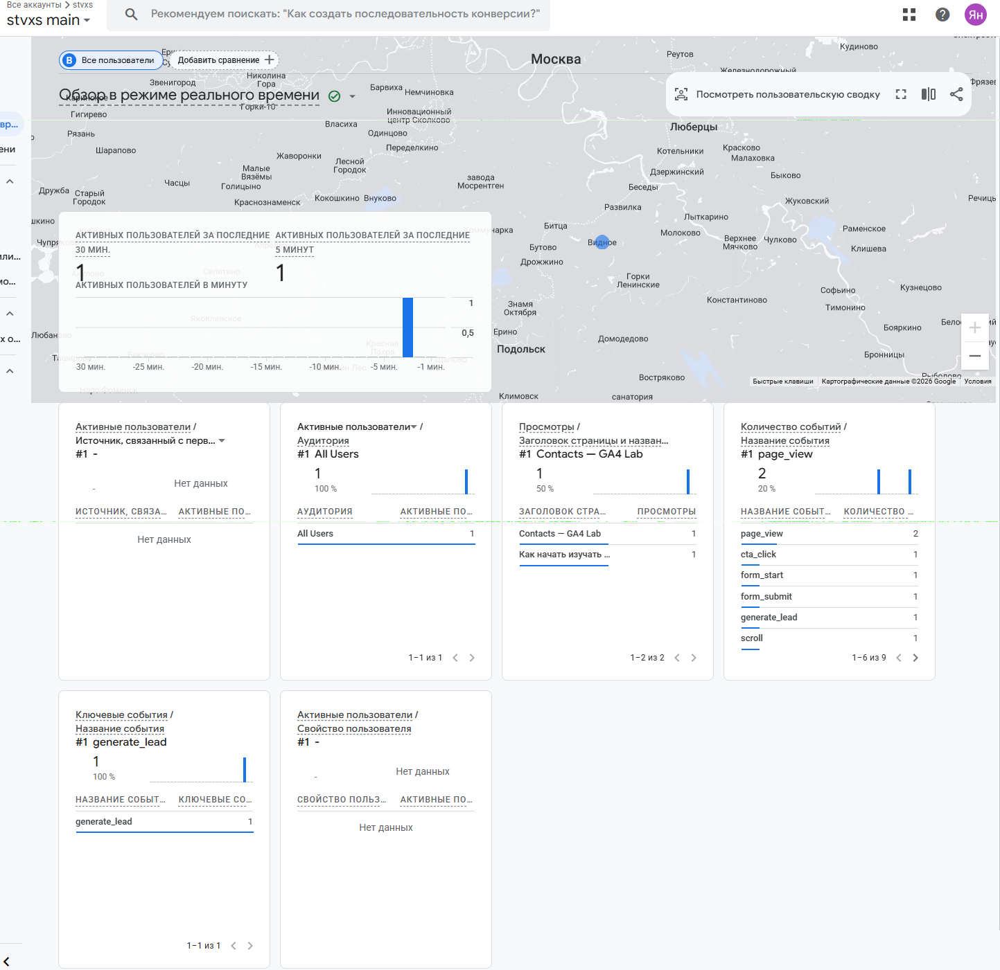
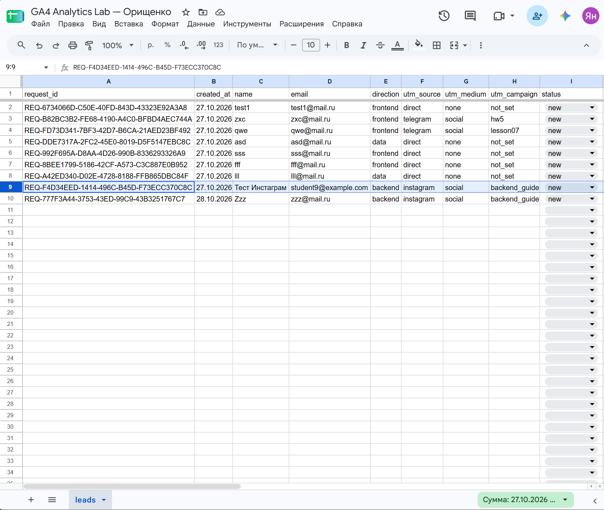

# Скриншоты задания 7

Формат PNG. Имена файлов:

| Файл | Что на кадре |
|---|---|
| `01-connected.png` | настройки ManyChat: Instagram в состоянии Connected |
| `02-flow.png` | Flow Builder целиком: триггер, Public Reply, Private Reply, кнопка; статус Live |
| `03-trigger.png` | настройки триггера: выбранная публикация и ключевое слово `ГАЙД` |
| `04-comment.png` | под публикацией комментарий `ГАЙД` и автоматический ответ |
| `05-direct.png` | Direct тестового аккаунта: сообщение и кнопка «Получить материал» (снимок с телефона) |
| `06-guide-utm.png` | `guide.html` в браузере, адрес с UTM виден целиком |
| `07-ga4.png` | `page_view` и `generate_lead` в Realtime или DebugView |
| `08-lead.png` | строка в листе `leads`: `instagram` / `social` / `backend_guide` |

На кадрах должны быть видны имя учебного аккаунта Instagram, адрес своего
сайта и свой Measurement ID. Чужие аватарки, список чатов и личную
переписку замажьте.

Этот файл удалять не нужно.
